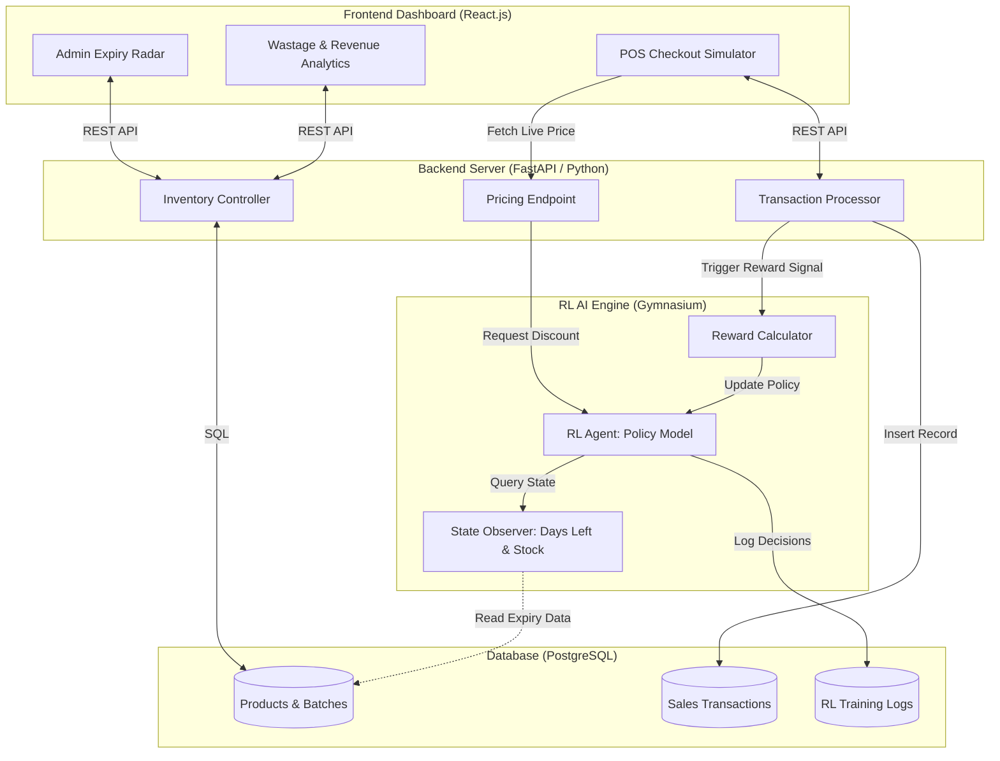
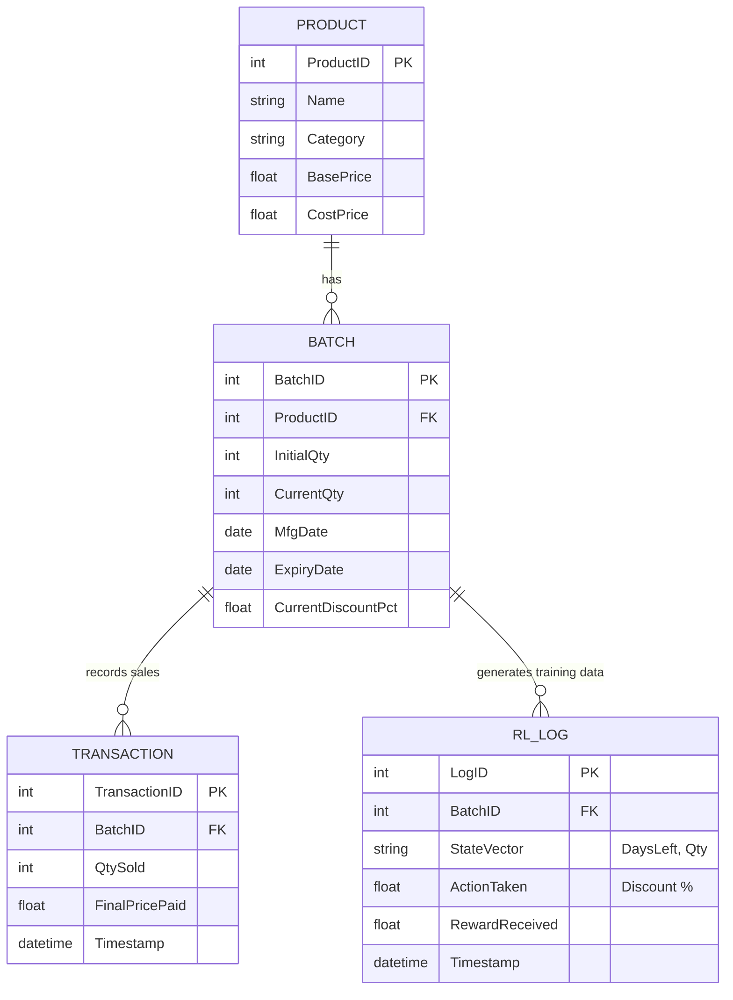
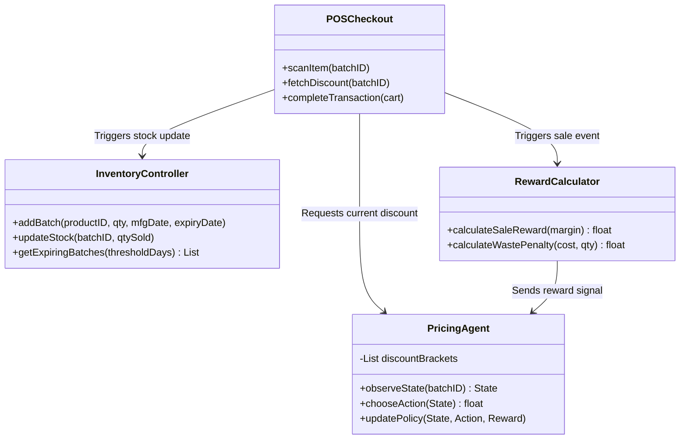
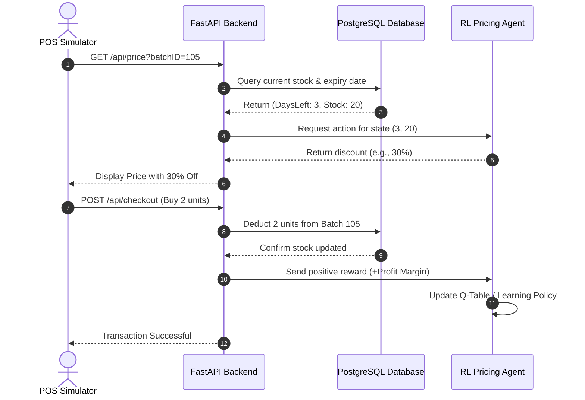
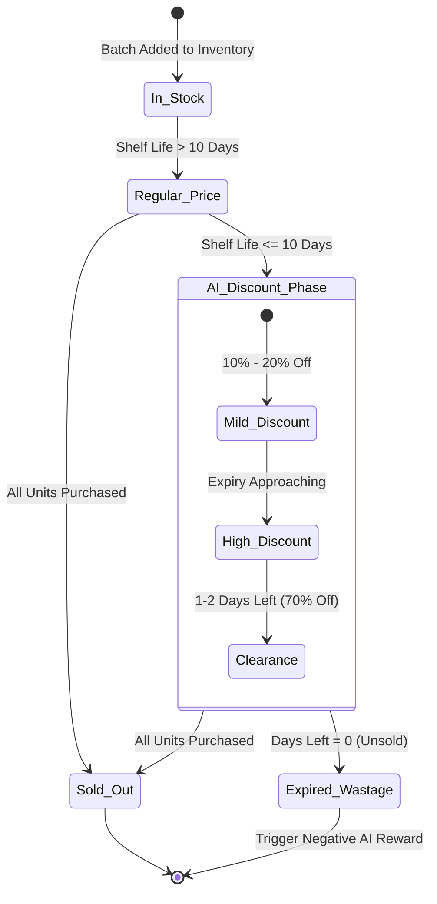

# AI-Based Expiry-Aware Dynamic Discount System 🏷️📉


## 📖 Project Overview
This project is a full-stack, AI-driven inventory management and Point-of-Sale (POS) dashboard. Based on research for expiration-aware pricing, the system replaces static markdown rules with an **Adaptive Reinforcement Learning (RL) Engine**. 

The AI agent dynamically adjusts discount percentages based on real-time inventory levels and remaining shelf-life to maximize revenue while minimizing food and product wastage.

---

## 🧩 Core Modules: What to Do & How to Build It

This system is divided into four main modules. Below is a clear breakdown of what each module does and the professional strategy for implementing it.

### Module 1: Inventory & Product Management (The Data Foundation)
* **What it does:** Tracks all store catalog items, specific batch deliveries, and monitors shelf life in real-time.
* **How to build it:**
  1. **Database Setup:** Use PostgreSQL to create `Product` and `Batch` tables. Ensure batches have `mfg_date` and `expiry_date` columns.
  2. **API Endpoints:** Build REST APIs in FastAPI to Create, Read, Update, and Delete (CRUD) products and batches.
  3. **Expiry Radar (Cron Job):** Write a background task (using Python's `APScheduler` or `Celery`) that runs daily at midnight to calculate the remaining shelf life (`Days Left = Expiry - Today`) for every active batch.

### Module 2: Reinforcement Learning (RL) Engine (The AI Brain)
* **What it does:** Calculates optimal dynamic discounts (e.g., 10%, 30%, 50%) based on real-time inventory conditions to avoid waste.
* **How to build it:**
  1. **Environment Setup:** Use Python's `Gymnasium` library to create a custom retail environment.
  2. **State & Action Definition:** Define the State as `[Days Until Expiry, Unsold Stock]` and Actions as discrete discount percentages `[0%, 15%, 30%, 50%, 75%]`.
  3. **Reward Logic:** Code a reward function that returns a positive number (Profit Margin) when an item sells, and a highly negative number (-Cost Price) when an item reaches 0 days and expires.
  4. **Training:** Implement a Q-Learning or PPO algorithm to let the agent learn offline using simulated data, then save the trained model as a `.pkl` or `.pt` file for the live server to use.

### Module 3: POS & Checkout Simulator (The Transaction Engine)
* **What it does:** Simulates a retail checkout, proving the AI responds correctly to purchasing behavior and stock reduction.
* **How to build it:**
  1. **Pricing Fetcher API:** Create a FastAPI endpoint `/api/price/` that the frontend calls when an item is scanned. This API queries the RL model (Module 2) to get the live discount.
  2. **Transaction Logic:** Build a POST endpoint for the checkout cart. When a user buys an item, deduct the quantity from the specific Batch in the database.
  3. **AI Feedback Loop:** Immediately after the stock is deducted, send the financial result (Profit) back to the RL Engine so it can update its learning policy in real time.

### Module 4: Full-Stack Admin Dashboard (UI & Analytics)
* **What it does:** The visual interface for store managers to monitor inventory, review AI decisions, and see financial analytics.
* **How to build it:**
  1. **Frontend Framework:** Scaffold a React application using Vite and Tailwind CSS.
  2. **Inventory View:** Build a data table fetching data from Module 1. Color-code the rows: Red (1-2 days left), Yellow (3-5 days), Green (Safe).
  3. **POS View:** Build a simple split-screen layout with a barcode scanner simulation on the left and a shopping cart on the right.
  4. **Analytics Dashboard:** Use a charting library like `Recharts` to plot "Revenue Saved" vs "Wastage Cost" over time to prove the AI's ROI.

---

## 🏗️ System Architecture Diagrams

### 1. High-Level Architecture Flow
This shows how the frontend, backend, database, and AI engine communicate.



### 2. Database Schema (ER Diagram)
Defines the relational data structure required for the system.



### 3. Object-Oriented Class Diagram
Outlines the backend code structure, classes, and methods.



### 4. POS Checkout & AI Learning Flow (Sequence Diagram)
Shows the exact order of operations when a customer buys a discounted item.



### 5. Product Batch Lifecycle (State Diagram)
Shows how a batch of goods transitions from full price to clearance to sold out/expired.



---

## 🛠️ Tech Stack
* **Frontend UI:** React.js, Vite, Tailwind CSS
* **Data Visualization:** Recharts, Chart.js
* **Backend API:** FastAPI (Python), Uvicorn, SQLAlchemy
* **AI/Machine Learning:** Python, Gymnasium, PyTorch / NumPy
* **Database:** PostgreSQL (Production) / SQLite (Local Development)

---

## 🚀 Step-by-Step Setup & Run Instructions

### Prerequisites
* Python 3.9+ installed
* Node.js v16+ installed
* Git installed

### 1. Backend & AI Setup (Terminal 1)
```bash
# Clone the repository
git clone [https://github.com/yourusername/dynamic-discount-system.git](https://github.com/yourusername/dynamic-discount-system.git)
cd dynamic-discount-system/backend

# Create and activate a virtual environment
python -m venv venv
source venv/bin/activate  # On Windows: venv\Scripts\activate

# Install Python dependencies
pip install -r requirements.txt

# Run initial database setup/migrations
alembic upgrade head

# Train the AI Model first (Offline Simulation)
python train_rl_agent.py

# Start the FastAPI backend server
uvicorn main:app --reload --port 8000
```
*API Documentation will be available at `http://localhost:8000/docs`*

### 2. Frontend Dashboard Setup (Terminal 2)
```bash
# Navigate to the frontend directory
cd dynamic-discount-system/frontend

# Install Node modules
npm install

# Start the React development server
npm run dev
```
*Access the Dashboard at `http://localhost:5173`*

---
*Based on research principles for AI-Based Expiry-Aware Dynamic Discount Systems.*
